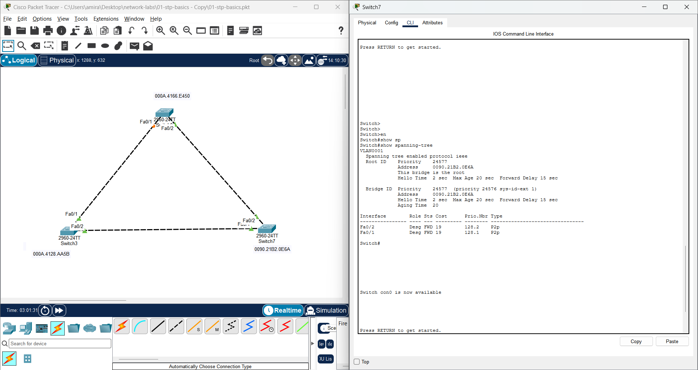

# Lab 02: Controlling the Root Bridge with `root primary`

## Objective
In Lab 01 the Root Bridge was chosen by the lowest MAC address, which is
not something you want in a real network. In this lab I force a specific
switch to become Root using `spanning-tree vlan 1 root primary`, then
verify how port roles change.

## Topology
Same 3-switch triangle as Lab 01, all links FastEthernet (cost 19).

| Switch | Bridge ID MAC | Priority before | Priority after |
|---|---|---|---|
| Switch0 | 000A.4166.E450 | 32769 | 32769 |
| Switch3 | 000A.4128.AA5B | 32769 | 32769 |
| Switch7 | 0090.21B2.0E6A | 32769 | 24577 |

## Configuration
On Switch7 only:

    Switch7(config)# spanning-tree vlan 1 root primary

The priority shown is 24577 = 24576 (base priority) + 1 (sys-id-ext, the VLAN ID).

## Before vs After

| | Lab 01 (default) | Lab 02 (root primary) |
|---|---|---|
| Root Bridge | Switch3 (lowest MAC) | Switch7 (lowest priority) |
| Blocking port | Fa0/2 on Switch7 | TODO: switch + port |

## Analysis
- Switch0 and Switch3 are both directly connected to Switch7 over
  FastEthernet, so each has Root Path Cost 19.
- TODO: Root Port of Switch0 and Switch3 (from `show spanning-tree`).
- The Switch0 <-> Switch3 link has no Root Port on either side, so the
  Designated Port is decided by Bridge ID. TODO: which one is lower, and
  which side ends up Blocking.

## Verification
`show spanning-tree` output from each switch is in `outputs/`.

## What I learned
- `root primary` lowers the priority automatically; changing the Root
  also changes which port is Blocking, because every role is recalculated.
- Priority is compared before MAC, so a manual priority overrides the
  "oldest switch wins" behavior.
- Switches are identified by Bridge ID, not Root ID.