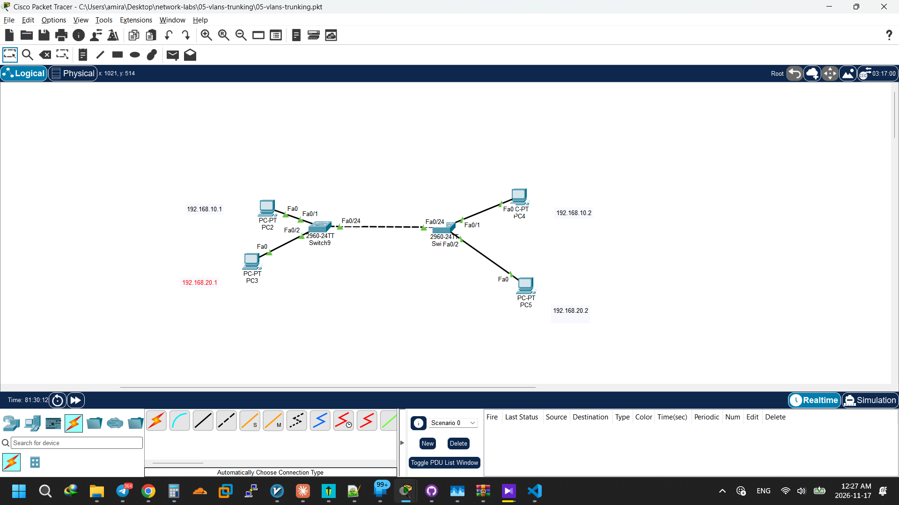

# Lab 05: VLANs and Trunking

## Objective
Split two switches into two VLANs (SALES and IT), connect them with an
802.1Q trunk, and verify which devices can communicate.

## Topology

| PC | Switch | Port | VLAN | IP address |
|---|---|---|---|---|
| PC2 | Switch9 | Fa0/1 | 10 (SALES) | 192.168.10.1/24 |
| PC3 | Switch9 | Fa0/2 | 20 (IT) | 192.168.20.1/24 |
| PC4 | Switch10 | Fa0/1 | 10 (SALES) | 192.168.10.2/24 |
| PC5 | Switch10 | Fa0/2 | 20 (IT) | 192.168.20.2/24 |

The switches are connected on Fa0/24 on both sides.

## Configuration
On both switches:

    Switch(config)# vlan 10
    Switch(config-vlan)# name SALES
    Switch(config)# vlan 20
    Switch(config-vlan)# name IT
    Switch(config)# interface fa0/1
    Switch(config-if)# switchport mode access
    Switch(config-if)# switchport access vlan 10
    Switch(config)# interface fa0/2
    Switch(config-if)# switchport mode access
    Switch(config-if)# switchport access vlan 20
    Switch(config)# interface fa0/24
    Switch(config-if)# switchport mode trunk

## Results
| Test | Before trunk | After trunk |
|---|---|---|
| PC2 to PC4 (VLAN 10 to VLAN 10) | 100% loss | 0% loss |
| PC2 to PC3 (VLAN 10 to VLAN 20) | (result) | (result) |

## Analysis
- Before the trunk, Fa0/24 was an access port in VLAN 1, so VLAN 10 frames
  could not cross the link and the two VLAN 10 PCs were isolated.
- After the trunk, the link carries several VLANs, and 802.1Q tags tell
  the other switch which VLAN each frame belongs to.
- When only one side was a trunk, Switch10 logged `Inconsistent port type`
  and STP blocked the port. Both sides must be configured the same way.
- Different VLANs are different subnets, so a Layer 2 switch cannot connect
  them. A router or Layer 3 switch is needed.

## What I learned
- (Write 2 bullets in your own words.)

## Verification
Outputs are in `outputs/`.