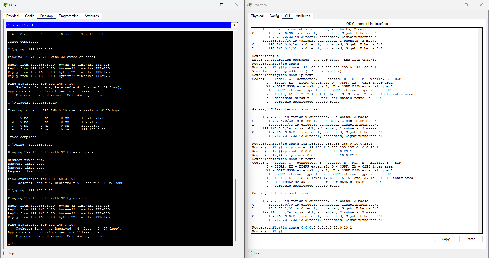
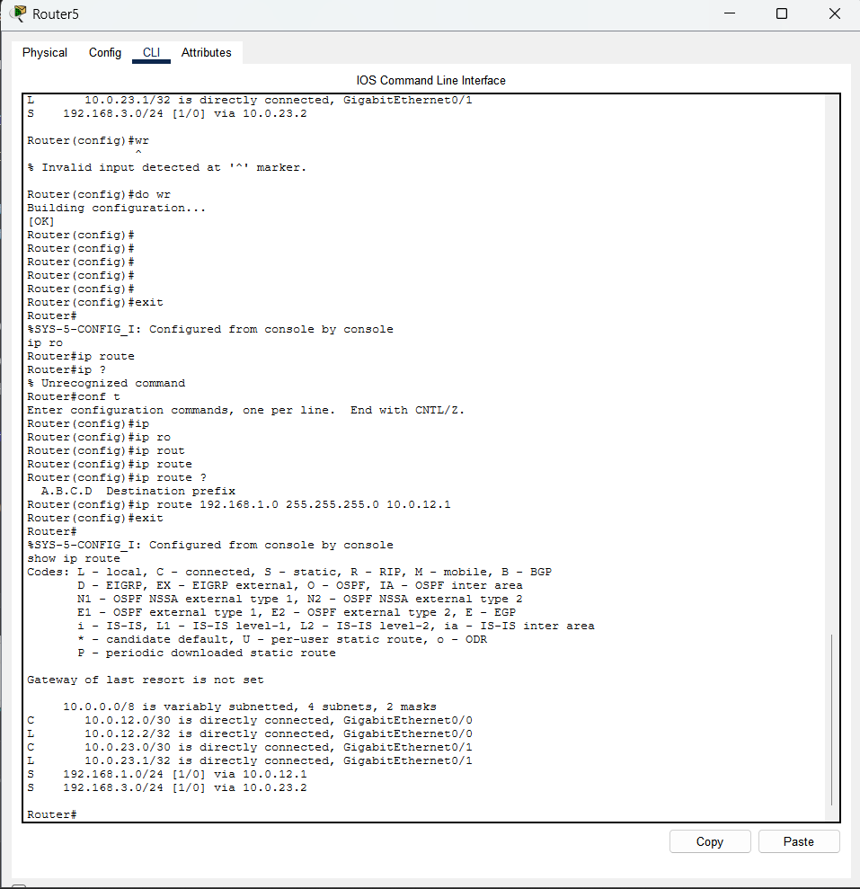

# Lab 07: Static and Default Routing

## Objective
Connect two LANs through three routers, and see what happens when a route
is missing on the way to the destination or on the way back.

## Topology

PC6 - Router4 - Router5 - Router6 - PC7

| Device | Interface | IP address |
|---|---|---|
| PC6 | Fa0 | 192.168.1.10/24, gateway 192.168.1.1 |
| Router4 | Gi0/0 | 192.168.1.1/24 |
| Router4 | Gi0/1 | 10.0.12.1/30 |
| Router5 | Gi0/0 | 10.0.12.2/30 |
| Router5 | Gi0/1 | 10.0.23.1/30 |
| Router6 | Gi0/0 | 10.0.23.2/30 |
| Router6 | Gi0/1 | 192.168.3.1/24 |
| PC7 | Fa0 | 192.168.3.10/24, gateway 192.168.3.1 |

## Configuration
Router5 (specific routes in both directions):

    Router5(config)# ip route 192.168.1.0 255.255.255.0 10.0.12.1
    Router5(config)# ip route 192.168.3.0 255.255.255.0 10.0.23.2

Router4 and Router6 (stub routers, default routes):

    Router4(config)# ip route 0.0.0.0 0.0.0.0 10.0.12.2
    Router6(config)# ip route 0.0.0.0 0.0.0.0 10.0.23.1

## Test steps and results
| Step | Configuration | PC6 to PC7 |
|---|---|---|
| 1 | IP addresses only | Destination host unreachable, sent by 192.168.1.1 |
| 2 | Route on Router4 only | Request timed out, tracert answers only at hop 1 |
| 3 | Routes on Router4 and Router5 | Request timed out, tracert answers at hops 1 and 2 |
| 4 | Specific routes on all three routers | Success, tracert shows 4 hops |
| 5 | Default routes on Router4 and Router6 | (add result) |
| 5 | Default routes on Router4 and Router6 | Success, TTL=125 (three routers) |
| 6 | Default route removed from Router6 | 100% loss: the request reaches PC7, but Router6 has no route back to 192.168.1.0/24 |
| 7 | Default route added again on Router6 | Success |

## Analysis
- A router needs a route to every network that is not directly connected,
  and the reply needs a route back to the source network.
- `Destination host unreachable` is sent by a router that has no route.
  `Request timed out` means that the request or the reply was lost further
  along the path.
- A `*` in tracert means that router did not answer. It does not always
  mean that the packet stopped there.

## What I learned
- A one-way route is not enough. Every router on the path needs a route to the
  destination network and a route back to the source network.
- A router creates a connected route for each interface, so a router can
  reply to a network it is directly connected to.
- A default route works on a stub router with one way out. A router in the
  middle, like Router5, needs specific routes for each direction.