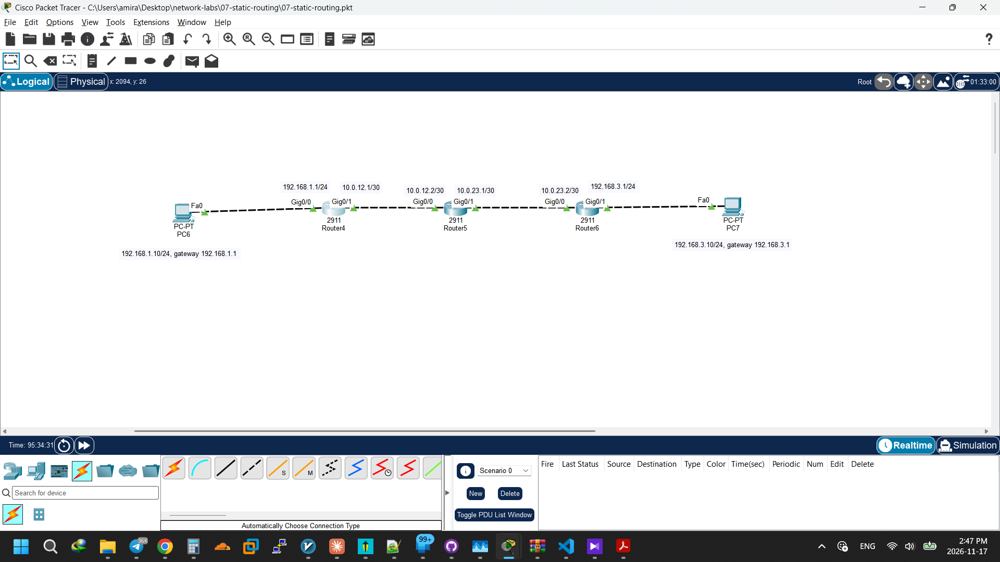

# Lab 08: OSPF Single Area

## Objective
Replace static routes with OSPF, and check how OSPF reacts when a link
fails.

## Topology

Same topology and IP addressing as Lab 07:
PC6 - Router4 - Router5 - Router6 - PC7. All routers are in area 0.

| Router | Router ID | Networks in OSPF |
|---|---|---|
| Router4 | 1.1.1.1 | 192.168.1.0/24, 10.0.12.0/30 |
| Router5 | 2.2.2.2 | 10.0.12.0/30, 10.0.23.0/30 |
| Router6 | 3.3.3.3 | 10.0.23.0/30, 192.168.3.0/24 |

## Configuration
Example for Router4:

    Router4(config)# router ospf 1
    Router4(config-router)# router-id 1.1.1.1
    Router4(config-router)# network 192.168.1.0 0.0.0.255 area 0
    Router4(config-router)# network 10.0.12.0 0.0.0.3 area 0

Router5 and Router6 use the same pattern with their own networks.

## Results
| Test | Result |
|---|---|
| Router5: `show ip ospf neighbor` | Two neighbors, both FULL |
| Router4: route to 192.168.3.0/24 | `O 192.168.3.0/24 [110/3] via 10.0.12.2` |
| PC6 to PC7 | Success, tracert shows 4 hops, TTL=125 |
| Router5 Gi0/1 shut down | Router4 loses all OSPF routes |
| Router5 Gi0/1 enabled again | OSPF routes return (add the final result) |

## Analysis
- The metric 3 is the sum of the outgoing interface costs along the path:
  Router4 Gi0/1 (1), Router5 Gi0/1 (1) and Router6 Gi0/1 (1).
- Router5 has two neighbors because it has two OSPF links, one to each router.
- (Write 2 sentences in your own words: why did Router4 lose the routes
  while its own link stayed up? Use Observation, Reason, Rule.)
- Ethernet links elect a DR and a BDR, even with only two routers on the link.

## What I learned
- OSPF removes a route when the link fails, and a static route does not.
- The metric is the sum of the outgoing interface costs along the path.
- (One bullet in your own words.)