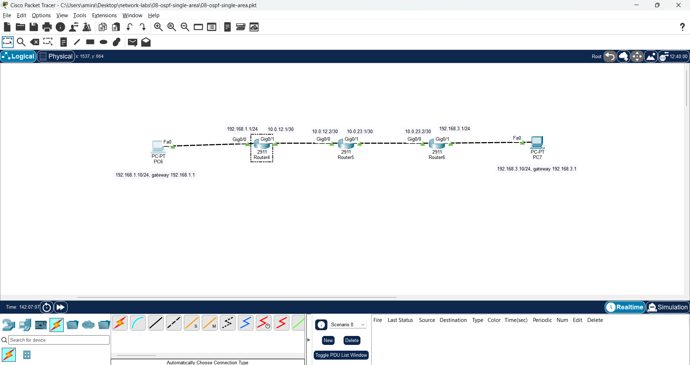
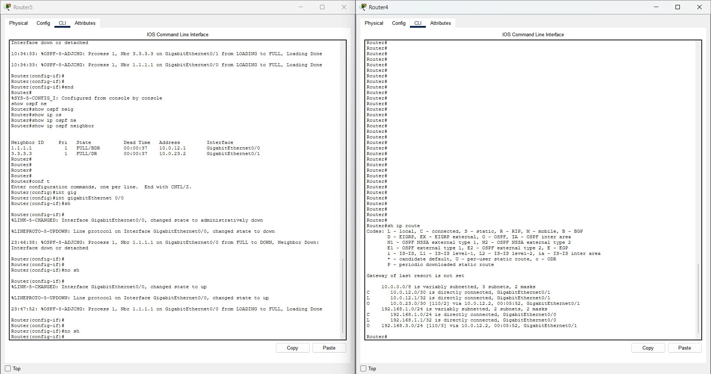
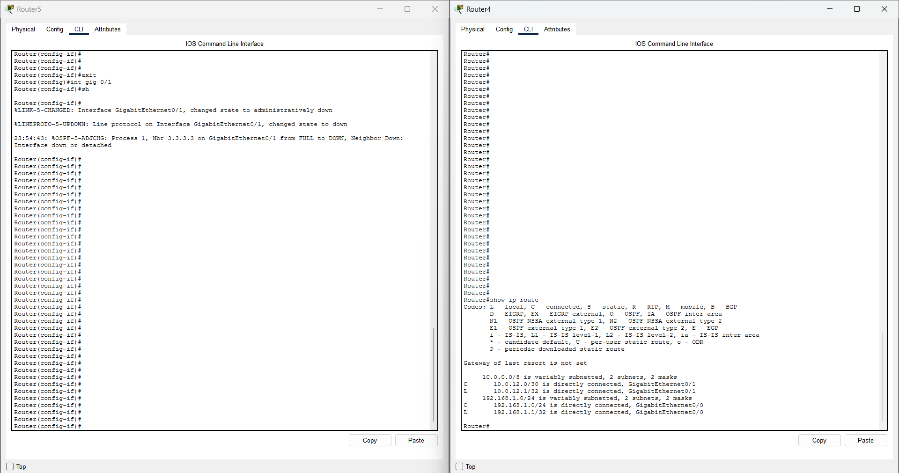
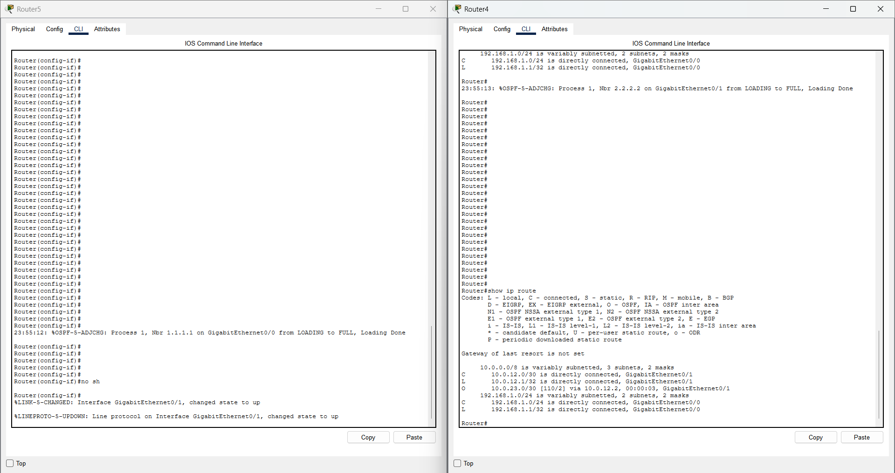

# Lab 08: OSPF Single Area

## Objective
Replace static routes with OSPF, and check how OSPF reacts when a link
fails.

## Topology

Same topology and IP addressing as Lab 07:
PC6 - Router4 - Router5 - Router6 - PC7. All routers are in area 0.

| Router | Router ID | Networks in OSPF |
|---|---|---|
| Router4 | 1.1.1.1 | 192.168.1.0/24, 10.0.12.0/30 |
| Router5 | 2.2.2.2 | 10.0.12.0/30, 10.0.23.0/30 |
| Router6 | 3.3.3.3 | 10.0.23.0/30, 192.168.3.0/24 |

## Configuration
Example for Router4:

    Router4(config)# router ospf 1
    Router4(config-router)# router-id 1.1.1.1
    Router4(config-router)# network 192.168.1.0 0.0.0.255 area 0
    Router4(config-router)# network 10.0.12.0 0.0.0.3 area 0

Router5 and Router6 use the same pattern with their own networks.

## Results
| Test | Result |
|---|---|
| Router5: `show ip ospf neighbor` | Two neighbors, both FULL |
| Router4: route to 192.168.3.0/24 | `O 192.168.3.0/24 [110/3] via 10.0.12.2` |
| PC6 to PC7 | Success, tracert shows 4 hops, TTL=125 |
| Router5 Gi0/1 shut down | Router4 loses all OSPF routes |
| Router5 Gi0/1 enabled again | OSPF routes return, including `O 192.168.3.0/24 [110/3]` |

## Analysis
- The metric 3 is the sum of the outgoing interface costs along the path:
  Router4 Gi0/1 (1), Router5 Gi0/1 (1) and Router6 Gi0/1 (1).
- Router5 has two neighbors because it has two OSPF links, one to each router.
- When the link between Router5 and Router6 failed, Router4 lost all OSPF
  routes, even though its own link stayed up. The routers on the failed
  link flooded an updated LSA, every router updated its LSDB, and each one
  recalculated the best paths with SPF. A static route would have stayed in
  the table.
- Ethernet links elect a DR and a BDR, even with only two routers on the link.

## What I learned
- OSPF removes a route when the link fails. A static route stays in the table
  as long as the link toward its next hop is up.
- The metric is the sum of the outgoing interface costs along the path.
- When a link fails, the routers flood updated LSAs, and every router
  recalculates the best paths with SPF.
- At first, I shut down the wrong link. That test also removed Router4's own
  link, so it could not show the difference between OSPF and a static route.